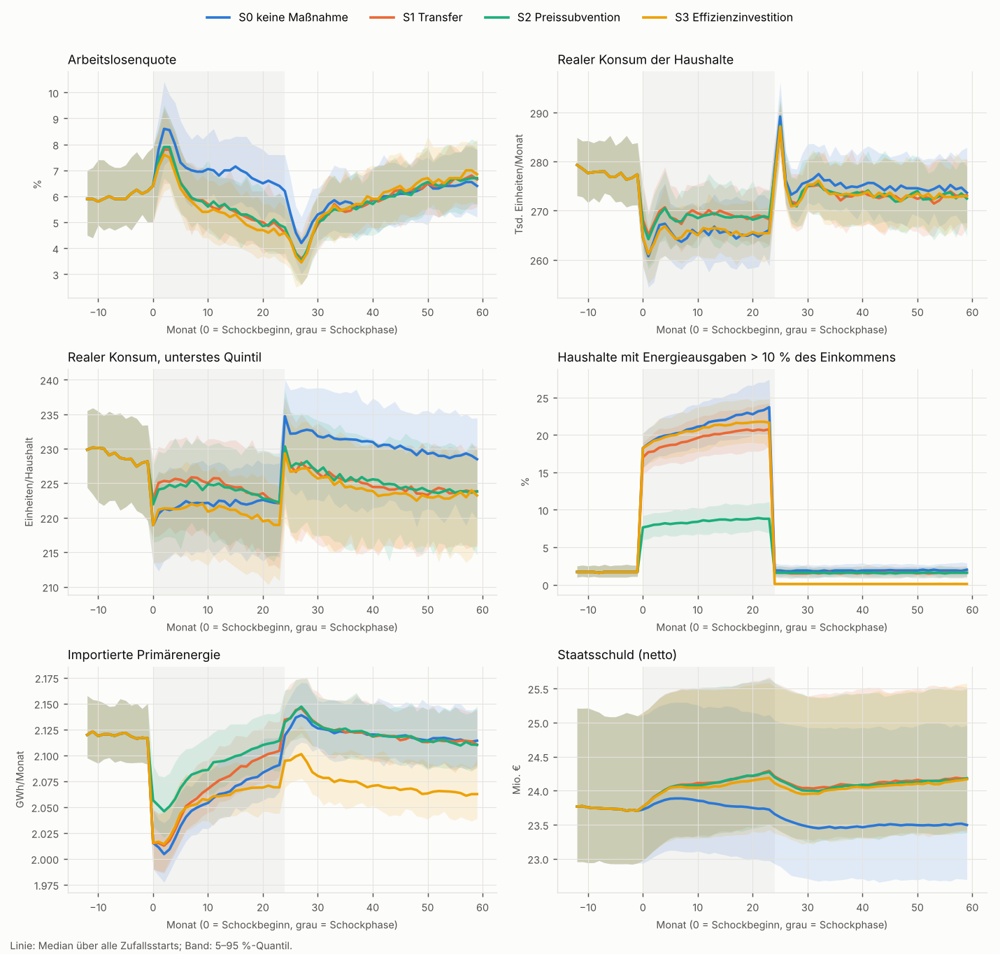
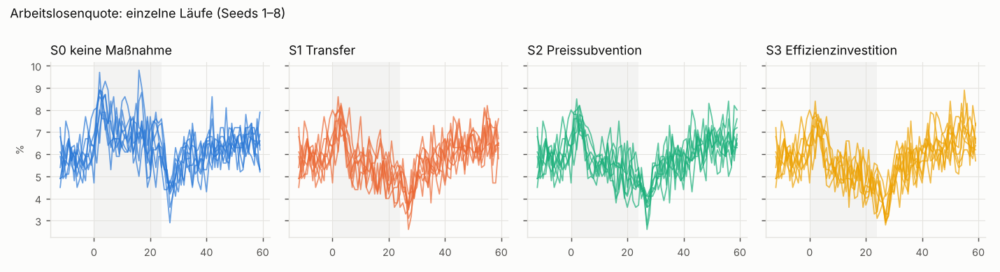

# Experiment: energy_shock

**Bedingte Aussage.** Alle Ergebnisse gelten nur innerhalb dieses stilisierten Modells mit seinen gesetzten, nicht kalibrierten Parametern und Verhaltensregeln. Sie sind keine Prognose.

- Läufe: 500 (100 Seeds × 5 Szenarien), gemeinsame Zufallszahlen über alle Szenarien
- Code: `ef7f4c696d98`
- Laufzeit: 71.6 s Wandzeit auf 4 Prozessen
- Buchführungsinvarianten: passed in every period of every run (a violation aborts the run)
- Replay-Prüfung (Lauf ['S0_none', 1] erneut gerechnet): bitgleich
- Programmbudget je Instrument: Median 1.03 Mio. € (Spanne 0.9984–1.07) über 24 Monate
- Parameterstatus laut Profilen: assumed: 12

## Verläufe

## Niveaus (Median über Seeds)

| Indikator | Beschreibung | Einheit | S0_none | S1_transfer | S2_subsidy | S3_investment |
|---|---|---|---|---|---|---|
| unemployment_shock | Arbeitslosenquote, Mittel Monate 0–23 | Anteil | 0.0703 | 0.0585 | 0.0588 | 0.0561 |
| unemployment_after | Arbeitslosenquote, Mittel Monate 24–59 | Anteil | 0.0590 | 0.0574 | 0.0573 | 0.0583 |
| unemployment_peak | Arbeitslosenquote, Maximum Monate 0–59 | Anteil | 0.0900 | 0.0840 | 0.0840 | 0.0835 |
| recovery_months | Monate bis Arbeitslosigkeit wieder ≤ Vorkrisenniveau + 1 Pp. | Monate | 6.00 | 5.00 | 5.00 | 5.00 |
| real_consumption_shock | Realer Konsum aller Haushalte, Mittel 0–23 | Gütereinheiten/Monat | 265 297 | 269 003 | 268 598 | 265 390 |
| q1_real_consumption_shock | Realer Konsum unterstes Einkommensquintil, Mittel 0–23 | Einheiten/Haushalt | 222 | 224 | 224 | 221 |
| q5_real_consumption_shock | Realer Konsum oberstes Einkommensquintil, Mittel 0–23 | Einheiten/Haushalt | 432 | 441 | 440 | 437 |
| energy_burden_shock | Anteil Haushalte mit Energieausgaben > 10 % des Nettoeinkommens, 0–23 | Anteil | 0.2143 | 0.1950 | 0.0845 | 0.2076 |
| q1_energy_burden_shock | dto., unterstes Quintil | Anteil | 0.2423 | 0.2222 | 0.1000 | 0.2354 |
| forced_shortfall_shock | Anteil Haushalte, die gewünschte Energie nicht bezahlen können, 0–23 | Anteil | 0 | 0 | 0 | 0 |
| energy_imports_shock | Importierte Primärenergie, Summe 0–23 | GWh | 49.30 | 49.56 | 50.07 | 49.23 |
| energy_imports_after | Importierte Primärenergie, Summe 24–59 | GWh | 76.26 | 76.34 | 76.32 | 74.59 |
| price_index_shock | Güterpreisindex 0–23 relativ zu Vorkrisenniveau | Faktor | 1.03 | 1.04 | 1.04 | 1.04 |
| gini_income_shock | Gini verfügbares Einkommen, Mittel 0–23 | Index | 0.1496 | 0.1490 | 0.1518 | 0.1511 |
| gini_deposits_end | Gini Einlagen (ohne Unternehmensbeteiligungen), Monat 59 | Index | 0.3299 | 0.3353 | 0.3352 | 0.3356 |
| hhi_goods_shock | Herfindahl-Index Gütermarkt, Mittel 0–23 | Index | 0.0550 | 0.0544 | 0.0545 | 0.0542 |
| firm_exits | Firmenaustritte 0–59 | Anzahl | 0 | 0 | 0 | 0 |
| bank_write_offs | Kreditabschreibungen der Bank 0–59 | Mio. € | 0 | 0 | 0 | 0 |
| gov_debt_change | Veränderung Staatsschuld (netto) Monat −1 bis 59 | Mio. € | -0.2148 | 0.4771 | 0.4554 | 0.4601 |
| policy_cost | Tatsächliche Programmkosten 0–59 | Mio. € | 0 | 1.03 | 1.00 | 1.03 |

## Gepaarte Differenzen zu S0_none

Differenz Szenario − Referenz je Seed (gleiche Zufallszahlen). `share_positive` = Anteil der Seeds mit positiver Differenz. Alle Zahlen: `paired_differences.csv`.

### S1 Transfer

| indicator | q05 | median | q95 | share_positive |
|---|---|---|---|---|
| unemployment_shock | -0.0162 | -0.0119 | -0.0090 | 0 |
| unemployment_after | -0.0054 | -0.0012 | 0.0026 | 0.3400 |
| unemployment_peak | -0.0140 | -0.0070 | 0.0010 | 0.0600 |
| recovery_months | -6.05 | -1.00 | 52.05 | 0.2800 |
| real_consumption_shock | 2 998 | 3 729 | 4 588 | 1.00 |
| q1_real_consumption_shock | 0.9256 | 2.57 | 4.66 | 1.00 |
| q5_real_consumption_shock | 4.18 | 8.57 | 11.40 | 1.00 |
| energy_burden_shock | -0.0241 | -0.0177 | -0.0117 | 0 |
| q1_energy_burden_shock | -0.0327 | -0.0198 | -0.0085 | 0 |
| forced_shortfall_shock | 0 | 0 | 0 | 0 |
| energy_imports_shock | 0.2159 | 0.2842 | 0.3837 | 1.00 |
| energy_imports_after | -0.0902 | 0.0445 | 0.1932 | 0.6500 |
| price_index_shock | 0.0059 | 0.0131 | 0.0183 | 1.00 |
| gini_income_shock | -0.0053 | 0.0004 | 0.0041 | 0.5500 |
| gini_deposits_end | -0.0006 | 0.0057 | 0.0115 | 0.9100 |
| hhi_goods_shock | -0.0012 | -0.0006 | -0.0000 | 0.0500 |
| firm_exits | 0 | 0 | 0 | 0 |
| bank_write_offs | 0 | 0 | 0 | 0 |
| gov_debt_change | 0.5724 | 0.6845 | 0.7877 | 1.00 |
| policy_cost | 1.01 | 1.03 | 1.05 | 1.00 |

### S2 Preissubvention

| indicator | q05 | median | q95 | share_positive |
|---|---|---|---|---|
| unemployment_shock | -0.0157 | -0.0118 | -0.0078 | 0 |
| unemployment_after | -0.0063 | -0.0013 | 0.0037 | 0.2900 |
| unemployment_peak | -0.0150 | -0.0060 | 0.0010 | 0.0700 |
| recovery_months | -6.00 | -0.5000 | 53.00 | 0.2800 |
| real_consumption_shock | 2 620 | 3 394 | 4 159 | 1.00 |
| q1_real_consumption_shock | 0.4223 | 2.19 | 3.97 | 0.9800 |
| q5_real_consumption_shock | 3.73 | 7.87 | 11.41 | 1.00 |
| energy_burden_shock | -0.1470 | -0.1280 | -0.1111 | 0 |
| q1_energy_burden_shock | -0.1748 | -0.1419 | -0.1114 | 0 |
| forced_shortfall_shock | 0 | 0 | 0 | 0 |
| energy_imports_shock | 0.6858 | 0.7935 | 0.8799 | 1.00 |
| energy_imports_after | -0.1331 | 0.0450 | 0.2251 | 0.7100 |
| price_index_shock | 0.0059 | 0.0122 | 0.0187 | 1.00 |
| gini_income_shock | -0.0027 | 0.0023 | 0.0058 | 0.7800 |
| gini_deposits_end | -0.0015 | 0.0053 | 0.0112 | 0.9000 |
| hhi_goods_shock | -0.0013 | -0.0005 | 0.0000 | 0.0600 |
| firm_exits | 0 | 0 | 0 | 0 |
| bank_write_offs | 0 | 0 | 0 | 0 |
| gov_debt_change | 0.5422 | 0.6647 | 0.7590 | 1.00 |
| policy_cost | 0.9823 | 1.00 | 1.02 | 1.00 |

### S3 Effizienzinvestition

| indicator | q05 | median | q95 | share_positive |
|---|---|---|---|---|
| unemployment_shock | -0.0186 | -0.0142 | -0.0110 | 0 |
| unemployment_after | -0.0050 | -0.0002 | 0.0042 | 0.4600 |
| unemployment_peak | -0.0150 | -0.0085 | 0.0030 | 0.0600 |
| recovery_months | -5.05 | 0 | 54.00 | 0.4200 |
| real_consumption_shock | -547 | 129 | 885 | 0.6000 |
| q1_real_consumption_shock | -2.99 | -1.22 | 0.2897 | 0.0900 |
| q5_real_consumption_shock | 1.69 | 5.13 | 8.94 | 0.9800 |
| energy_burden_shock | -0.0124 | -0.0069 | -0.0016 | 0 |
| q1_energy_burden_shock | -0.0192 | -0.0072 | 0.0034 | 0.1200 |
| forced_shortfall_shock | 0 | 0 | 0 | 0 |
| energy_imports_shock | -0.1172 | -0.0404 | 0.0764 | 0.2800 |
| energy_imports_after | -1.94 | -1.71 | -1.51 | 0 |
| price_index_shock | 0.0079 | 0.0139 | 0.0200 | 1.00 |
| gini_income_shock | -0.0012 | 0.0024 | 0.0065 | 0.8400 |
| gini_deposits_end | 0.0003 | 0.0067 | 0.0116 | 0.9600 |
| hhi_goods_shock | -0.0014 | -0.0008 | -0.0002 | 0 |
| firm_exits | 0 | 0 | 0 | 0 |
| bank_write_offs | 0 | 0 | 0 | 0 |
| gov_debt_change | 0.5650 | 0.6694 | 0.7645 | 1.00 |
| policy_cost | 1.01 | 1.03 | 1.05 | 1.00 |

## Mechanismus-Erwartungen (vorab festgelegt)

Anteil der Seeds, in denen die Erwartung zutrifft. Prüft die Umsetzung der Mechanismen, nicht die Wirklichkeit.

| ID | Erwartung | Anteil Seeds |
|---|---|---|
| E1 | Subvention: höhere Energieimporte als Transfer (Monate 0–23) | 1.00 |
| E2 | Transfer: höherer realer Konsum im untersten Quintil als Subvention (0–23) | 0.68 |
| E2b | Transfer: geringerer Anteil Energiekostenbelastung > 10 % im untersten Quintil als Subvention | 0.00 |
| E3a | Investition: geringere Energieimporte als S0 nach Monat 24 | 1.00 |
| E3b | Investition: geringere Energieimporte als Transfer nach Monat 24 | 1.00 |
| E3c | Investition: kurzfristig schwächere Entlastung Q1 als Transfer (realer Konsum 0–23) | 0.99 |

## Quasistationarität der Basis (Kontrolllauf ohne Schock)

Mittel Monate 48–59 gegenüber −12…−1.

| Größe | Maß | q05 | Median | q95 |
|---|---|---|---|---|
| unemployment | Differenz (Pp./100) | -0.0055 | 0.0053 | 0.0153 |
| price_index | relative Änderung | -0.0185 | 0.0106 | 0.0424 |
| avg_wage | relative Änderung | -0.0519 | -0.0165 | 0.0061 |
| money_stock | relative Änderung | -0.0052 | 0.0008 | 0.0054 |
| real_consumption | relative Änderung | -0.0172 | -0.0083 | -0.0006 |

## Entscheidungsmodelle

| Komponente | Modell | Art | Aufrufe | Einzelentscheidungen | Sekunden | ungültige Aktionen |
|---|---|---|---|---|---|---|
| household_model | household_budget_rule 0.1.0 | rule | 60000 | 60000000 | 3.66 | 0 |
| firm_model | firm_planning_rule 0.1.0 | rule | 60000 | 1200000 | 5.49 | 0 |
| energy_model | energy_supplier_rule 0.1.0 | rule | 60000 | 180000 | 0.72 | 0 |
| credit_model | leverage_credit_rule 0.1.0 | rule | 60000 | 1380000 | 0.61 | 0 |

Laufzeit-Flags (Summe über alle Läufe): {'bank_negative_equity_months': 0, 'overdraft_events': 0}
